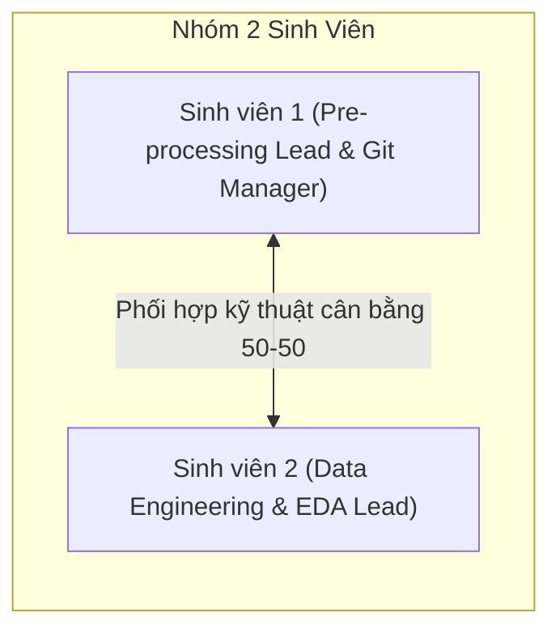

# 01. Tổng Quan Dự Án

## 1. Giới Thiệu Đề Tài
Đồ án mang tên: **"Nghiên cứu và xây dựng hệ thống tự động phát hiện bình luận độc hại đa nhãn (Multi-Label Toxic Comment Detection) trên mạng xã hội tiếng Việt"**.

Được thực hiện bởi nhóm 2 sinh viên (SV1 và SV2), đề tài tập trung giải quyết bài toán xử lý ngôn ngữ tự nhiên (NLP) thực tế trên mạng xã hội Việt Nam (Facebook, TikTok, YouTube). Hệ thống tiếp nhận các bình luận văn bản tự do, tiến hành tiền xử lý chuẩn hóa đặc thù tiếng Việt, và đưa qua các mô hình học sâu để dự đoán đồng thời các sắc thái vi phạm theo cơ chế phân loại đa nhãn (Multi-label).

---

## 2. Mục Đích & Ý Nghĩa Thực Tiễn

* **Mục đích nghiên cứu:** Khảo sát, xây dựng và so sánh hiệu năng giữa các nhóm mô hình từ truyền thống (Machine Learning với TF-IDF), học sâu cổ điển (BiLSTM + Attention) đến các mô hình ngôn ngữ lớn dựa trên Transformer tiền huấn luyện chuyên sâu cho tiếng Việt (PhoBERT, ViDeBERTa).
* **Mục đích ứng dụng:** Cung cấp một module phát hiện bình luận vi phạm có khả năng triển khai thực tế, tích hợp giao diện Web Demo cho phép phân loại và tô màu trực quan các từ ngữ tiêu cực/thù ghét trong thời gian thực.
* **Tính cấp thiết:** Trên không gian mạng xã hội hiện nay, lượng bình luận thô tục, công kích cá nhân và phát ngôn thù ghét gia tăng nhanh chóng, gây ảnh hưởng tiêu cực đến văn hóa ứng xử và tâm lý người dùng. Việc kiểm duyệt thủ công là bất khả thi về mặt quy mô, đòi hỏi một hệ thống tự động hóa có độ chính xác cao và hiểu sâu sắc ngữ cảnh tiếng Việt hiện đại.

---

## 3. Nhân Sự & Vai Trò Dự Án

Dự án áp dụng nguyên tắc **phân chia cân bằng 50-50** về cả trách nhiệm, công việc kỹ thuật lẫn sản phẩm bàn giao giữa 2 sinh viên:

* **Sinh viên 1 (SV1):**
  * Quản lý Repository GitHub, thiết lập môi trường và luồng nhánh (Branching workflow).
  * Xây dựng từ điển chuẩn hóa Teencode (`teencode.json`).
  * Phát triển các hàm chuẩn hóa văn bản regex, Unicode trong module `src/preprocessing.py`.
  * Phối hợp chia tập dữ liệu và phân tích EDA (độ dài câu, thống kê token).
  * Fine-tune mô hình PhoBERT và phát triển giao diện Web Demo Streamlit.

* **Sinh viên 2 (SV2):**
  * Quản lý lưu trữ backup trên Google Drive cho dữ liệu và checkpoints.
  * Thu thập dữ liệu thô từ các nguồn học thuật (ViHSD, ViCTSD, ViTHSD).
  * Xây dựng từ điển ánh xạ biểu tượng cảm xúc (`emoji.json`).
  * Xây dựng cấu trúc đa nhãn và tích hợp tách từ (`underthesea`) vào pipeline làm sạch.
  * Phối hợp chia tập dữ liệu và phân tích EDA (phân bố nhãn, mức độ mất cân bằng).
  * Fine-tune mô hình ViDeBERTa, tính toán các chỉ số đánh giá chuyên sâu và viết báo cáo thuyết minh.

---

## 4. Các Sản Phẩm Bàn Giao Kỳ Vọng (Deliverables)

Dự án hướng đến bộ sản phẩm hoàn chỉnh theo chuẩn công nghiệp:

1. **Mã nguồn GitHub (GitHub Repository):**
   * Repo có cấu trúc dạng module (`assets/`, `data/`, `notebooks/`, `src/`, `app/`, `saved_models/`).
   * Tuân thủ quy trình Git Branch, có lịch sử commit và Pull Request rõ ràng.
   * File `README.md` hướng dẫn chạy lại (reproducibility) đầy đủ.
2. **Kho Dữ Liệu & Model Backup:**
   * Thư mục Google Drive lưu trữ các tập dữ liệu CSV thô và sạch (`train.csv`, `val.csv`, `test.csv`).
   * Checkpoint và trọng số mô hình tốt nhất (`.pth`, Hugging Face bin/safetensors).
3. **Bộ Notebook Nghiệm Thu (Jupyter Notebooks):**
   * Notebook 01: EDA và kiểm thử pipeline tiền xử lý dữ liệu.
   * Notebook 02: Huấn luyện và đánh giá Baseline TF-IDF + Classifier.
   * Notebook 03: Huấn luyện mạng học sâu BiLSTM + Attention.
   * Notebook 04: Huấn luyện và tinh chỉnh Transformer (PhoBERT & ViDeBERTa).
4. **Ứng Dụng Web Demo Tương Tác:**
   * Giao diện Streamlit cho phép người dùng nhập văn bản tùy ý.
   * Hiển thị xác suất đa nhãn (`toxic`, `hate`, `spam`, `clean`).
   * Tô màu cảnh báo trực quan các từ ngữ vi phạm theo thời gian thực.
5. **Tài Liệu Thuyết Minh:**
   * Báo cáo đồ án khoa học định dạng PDF.
   * Slide thuyết trình báo cáo nghiệm thu.
   * Video ghi lại quá trình vận hành của hệ thống và Web Demo.
