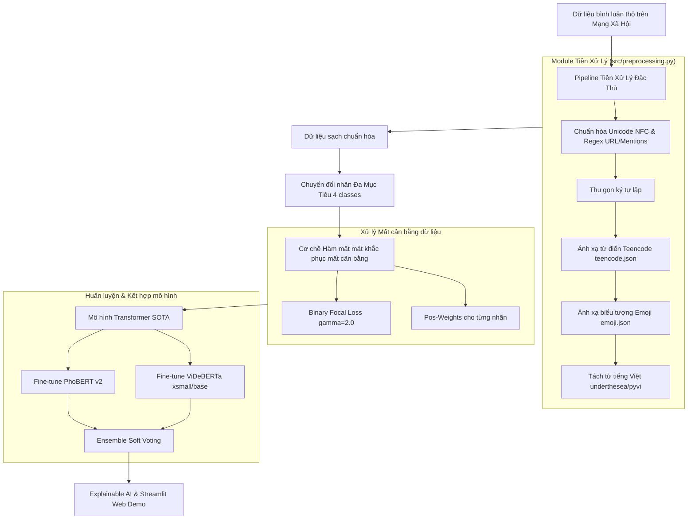

# 01. Vấn Đề Và Giải Pháp Kỹ Thuật

## 1. Các Thách Thức Đặc Thù Của Tiếng Việt Trên Mạng Xã Hội

Dữ liệu bình luận trên mạng xã hội tiếng Việt mang nhiều đặc tính phức tạp và nhiễu loạn cao:

| Thách thức | Biểu hiện thực tế | Tác động tiêu cực nếu không xử lý |
| :--- | :--- | :--- |
| **Teencode & Từ viết tắt** | `k`, `ko`, `khong` $\rightarrow$ không; `dc`, `dk` $\rightarrow$ được; `vcl`, `vl` $\rightarrow$ vãi lờ; `đm`, `dcm` $\rightarrow$ địt mẹ | Mô hình coi các từ này là từ mới (Out-of-Vocabulary - OOV), làm mất thông tin ngữ nghĩa then chốt |
| **Biểu tượng cảm xúc (Emoji)** | 😡, 🤬 biểu thị phẫn nộ/chửi bới; 💩 biểu thị xúc phạm; ❤️, 👍 biểu thị tích cực | Tokenizer mặc định thường bỏ qua hoặc mã hóa emoji thành token vô nghĩa |
| **Kéo dài ký tự (Elongated Chars)** | `ngonnnnn`, `vcllllll`, `quáaaaa` | Sinh ra vô số biến thể từ khác nhau trong không gian từ vựng |
| **Tiếng lóng & Vi phạm ẩn** | Sử dụng từ nói giảm nói tránh, chèn ký tự lạ để né bộ lọc | Gặp khó khăn trong việc nhận diện nếu chỉ dùng phương pháp khớp từ khóa đơn thuần |
| **Bảng mã ký tự (Encoding)** | Mâu thuẫn giữa Unicode NFC, NFD; mở file CSV UTF-8 trên Windows Excel bị lỗi thành Mojibake (`Coi cÆ°á» i`, `Nó`) | Làm sai lệch toàn bộ tập huấn luyện và lỗi xử lý chuỗi trong code |
| **Tách từ tiếng Việt** | Tiếng Việt là ngôn ngữ đơn lập, nghĩa phụ thuộc vào ranh giới từ ghép (ví dụ: `học sinh`, `lừa đảo`) | Transformer như PhoBERT đòi hỏi văn bản đã được phân tách từ trước (`học_sinh`, `lừa_đảo`) |
| **Mất cân bằng lớp (Class Imbalance)** | Nhãn bình thường (`clean`) chiếm đa số áp đảo (75% - 80%), nhãn độc hại và phát ngôn thù ghét (`hate`) cực kỳ khan hiếm | Mô hình có xu hướng đoán toàn bộ là `clean` để đạt accuracy cao nhưng Macro-F1 lại rất thấp |

---

## 2. Chiến Lược Giải Pháp Kỹ Thuật Tổng Thể

Nhóm đã thống nhất các giải pháp kỹ thuật theo từng lớp kiến trúc:

---

## 3. Chi Tiết Các Giải Pháp Trọng Tâm

### 3.1. Pipeline tiền xử lý văn bản chuyên sâu
* Xây dựng từ điển Teencode dạng JSON (`data/dictionaries/teencode.json`) bao quát các từ viết tắt, từ lóng xúc phạm phổ biến để quy đổi về dạng từ vựng tiếng Việt toàn vẹn.
* Xây dựng bộ ánh xạ Emoji dạng JSON (`data/dictionaries/emoji.json`) để phiên dịch cảm xúc thành văn bản tiếng Việt có nghĩa (ví dụ `😡` $\rightarrow$ `phẫn nộ`), hỗ trợ mô hình nhận thức rõ sắc thái cảm xúc.
* Tích hợp công cụ tách từ chuyên dụng (`underthesea` hoặc `pyvi`) để nối từ ghép bằng dấu gạch dưới `_`, tối ưu hóa việc phân tách token cho bộ từ vựng của PhoBERT (BPE/WordPiece).

### 3.2. Nâng cấp cấu trúc đa nhãn (Multi-Label)
Thay vì quy bài toán về phân loại nhị phân đơn giản (`Toxic` vs `Clean`), nhóm phân định chi tiết hành vi bình luận thành 4 nhãn đồng thời: `[toxic, hate, spam, clean]`. Điều này phản ánh đúng thực tế vì một phát ngôn có thể vừa thô tục vừa mang tính chất kích động thù ghét nhóm đối tượng.

### 3.3. Giải quyết mất cân bằng bằng Binary Focal Loss
Áp dụng cơ chế **Focal Loss** cho bài toán nhị phân đa nhãn:
$$FL(p_t) = -\alpha_t (1 - p_t)^\gamma \log(p_t)$$
Hàm mất mát này tự động giảm trọng số phạt đối với các mẫu dữ liệu dễ phân loại (như các bình luận an toàn chiếm số đông), và tập trung ép mô hình học kỹ các trường hợp khó phân loại và các lớp thiểu số (như `hate`).

### 3.4. Mô hình Transformer tiên tiến & Kỹ thuật Ensemble
Kết hợp hai kiến trúc Transformer mạnh nhất cho xử lý tiếng Việt:
1. **PhoBERT (vinai/phobert-base-v2):** Tối ưu hóa sâu trên cấu trúc từ ghép tiếng Việt.
2. **ViDeBERTa (nguyenvulebinh/vi-deberta-xsmall hoặc base):** Sở hữu cơ chế Disentangled Attention giúp phân tách rõ vị trí và nội dung của từ trong ngữ cảnh.
Hai mô hình được huấn luyện song song và kết hợp dự đoán thông qua cơ chế **Soft Voting** nhằm triệt tiêu sai số cục bộ và tối đa hóa chỉ số Macro-F1.

### 3.5. Minh bạch hóa dự đoán bằng XAI & Web Demo
* Ứng dụng Web Demo tương tác thời gian thực bằng Streamlit.
* Cung cấp cơ chế giải thích mô hình (Explainable AI): bắt đầu từ việc tô màu các từ ngữ vi phạm bằng danh mục từ nhạy cảm (`bad_words`), và nâng cấp bằng LIME/Attention Scores để làm nổi bật những từ ngữ khiến mô hình đưa ra phán quyết vi phạm.
