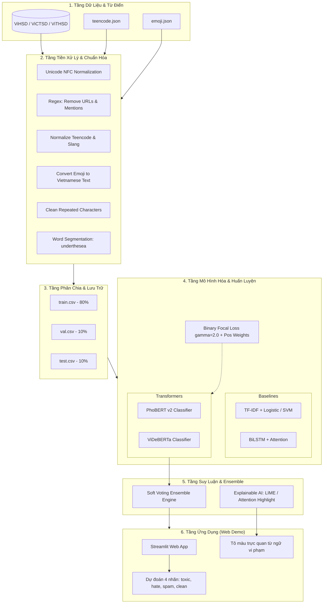

# 03. Kiến Trúc Tổng Thể Hệ Thống

## 1. Sơ Đồ Luồng Hoạt Động Toàn Tuyến (End-to-End Pipeline)

Hệ thống được thiết kế theo luồng kiến trúc đường ống (Pipeline Architecture) khép kín, phân định mạch lạc từ tầng thu thập dữ liệu, tầng tiền xử lý, tầng mô hình hóa đến tầng giao diện người dùng:



---

## 2. Cấu Trúc Mã Nguồn Dạng Mô-Đun (Modular Codebase Layout)

Dự án tuân thủ chuẩn tổ chức thư mục công nghiệp cho các bài toán Khoa học Dữ liệu / NLP:

```text
vietnamese-toxic-comment-detection/
├── assets/                          # Ảnh sơ đồ kiến trúc, biểu đồ kết quả báo cáo
├── data/                            # Quản lý dữ liệu dự án (loại trừ khỏi Git)
│   ├── raw/                         # Dữ liệu gốc tải về (ViHSD, ViCTSD, ViTHSD, merged_dataset.csv)
│   ├── processed/                   # Dữ liệu sạch sau tiền xử lý (train.csv, val.csv, test.csv)
│   └── dictionaries/                # Từ điển quy chuẩn dạng JSON
│       ├── teencode.json            # Ánh xạ teencode -> từ chuẩn
│       └── emoji.json               # Ánh xạ emoji -> chuỗi tiếng Việt
├── notebooks/                       # Thử nghiệm dạng Jupyter Notebook
│   ├── 01_eda_and_preprocessing.ipynb # Khảo sát dữ liệu, phân bố nhãn & độ dài câu
│   ├── 02_baseline_tfidf_svm.ipynb    # Huấn luyện mô hình cơ sở Machine Learning
│   ├── 03_baseline_bilstm_attention.ipynb # Huấn luyện mô hình học sâu BiLSTM
│   └── 04_phobert_fine_tuning.ipynb   # Thử nghiệm tinh chỉnh Transformer
├── src/                             # Mã nguồn Python đóng gói có thể tái sử dụng
│   ├── __init__.py                  # Đánh dấu package
│   ├── preprocessing.py             # Module dọn dẹp văn bản, teencode, emoji, tách từ
│   ├── dataset.py                   # PyTorch Dataset & DataCollator cho Multi-Label
│   ├── models.py                    # Định nghĩa lớp mô hình PhoBERT / ViDeBERTa
│   ├── loss.py                      # Cài đặt Binary Focal Loss & Weighted Loss
│   ├── utils.py                     # Hàm tính chỉ số Macro-F1, vẽ Confusion Matrix
│   └── train.py                     # Script dòng lệnh chạy huấn luyện mô hình
├── saved_models/                    # Lưu checkpoint, weights tốt nhất (loại trừ khỏi Git)
├── app/                             # Giao diện ứng dụng người dùng
│   ├── app.py                       # Ứng dụng Web tương tác Streamlit
│   └── highlight.py                 # Logic trích xuất & tô màu từ ngữ độc hại
├── project-docs/                    # Toàn bộ hệ thống tài liệu Markdown của dự án
├── requirements.txt                 # Danh sách thư viện và phiên bản phụ thuộc
├── .gitignore                       # Cấu hình bỏ qua file rác và file dung lượng lớn
└── README.md                        # Hướng dẫn tổng quan & cài đặt nhanh dự án
```

---

## 3. Nguyên Lý Vận Hành Các Thành Phần Chính

1. **Thành phần Dữ liệu (Data Component):**
   * Đọc các file dữ liệu bảng mã UTF-8 chuẩn.
   * Xử lý đa nhãn bằng cách chuyển đổi mỗi mẫu thành vector nhị phân 4 chiều $Y \in \{0, 1\}^4$.
2. **Thành phần Tiền xử lý (Preprocessing Component):**
   * Chạy hàm chuẩn hóa chuỗi tuần tự nhằm loại bỏ nhiễu kỹ thuật số, đồng thời bảo toàn các đặc trưng biểu đạt cảm xúc tiêu cực thông qua từ điển.
3. **Thành phần Huấn luyện & Tối ưu (Training & Loss Component):**
   * Huấn luyện độc lập PhoBERT v2 và ViDeBERTa với hàm mất mát Binary Focal Loss ($\alpha=0.25, \gamma=2.0$).
   * Tối ưu hóa siêu tham số bằng AdamW, warmup steps và learning rate scheduler.
4. **Thành phần Suy luận & Giao diện (Inference & UI Component):**
   * Khi người dùng nhập một câu bình luận vào Web UI, câu đó đi qua hàm `preprocess_vietnamese_text()`, được đưa đồng thời qua hai mô hình để lấy logits.
   * Cơ chế Soft Voting tính trung bình xác suất sigmoid $\hat{p} = \frac{1}{2}(p_{\text{phobert}} + p_{\text{videberta}})$.
   * Nếu xác suất của lớp `toxic` hoặc `hate` vượt qua ngưỡng phân loại ($0.5$), hệ thống kích hoạt module `highlight.py` để tô màu các từ ngữ vi phạm và cảnh báo người dùng.
