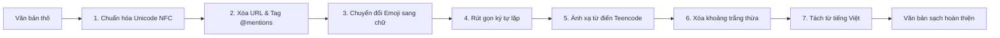

# 03. Thiết Kế Pipeline Tiền Xử Lý Văn Bản Tiếng Việt

## 1. Mục Tiêu & Nguyên Tắc Tiền Xử Lý

Mục tiêu cốt lõi của module tiền xử lý (`src/preprocessing.py`) là biến đổi các chuỗi bình luận mạng xã hội nhiều nhiễu thành định dạng văn bản chuẩn mực, giữ vững thông tin ngữ nghĩa nhạy cảm và tối ưu hóa cấu trúc đầu vào cho mô hình Transformer tiền huấn luyện (đặc biệt là PhoBERT).

**Nguyên tắc tiền xử lý:**
1. **Không làm mất đặc trưng độc hại:** Không tùy tiện loại bỏ các từ chửi thề hoặc tiếng lóng, mà chuẩn hóa chúng về dạng từ vựng nguyên bản để mô hình dễ nhận diện.
2. **Ngăn chặn lỗi bảng mã:** Chuẩn hóa toàn bộ về Unicode dạng dựng sẵn (NFC).
3. **Bảo toàn ngữ cảnh cảm xúc:** Biến đổi các Emoji biểu thị cảm xúc cực đoan (giận dữ, khinh bỉ) thành từ ngữ tiếng Việt tương đương thay vì xóa bỏ.
4. **Hỗ trợ tách từ ghép:** Kết hợp công cụ `underthesea` để nối các từ ghép tiếng Việt bằng ký tự gạch dưới `_`.

---

## 2. Thứ Tự Các Bước Xử Lý Tuần Tự (Pipeline Steps)

Quy trình chuẩn hóa một câu bình luận đầu vào tuân theo chuỗi bước sau:



---

## 3. Chi Tiết Thuật Toán & Mã Nguồn Từng Bước

### Bước 1: Chuẩn hóa Unicode NFC
Tiếng Việt có hai kiểu gõ Unicode: Tổ hợp (NFD) và Dựng sẵn (NFC). Sự bất đồng bộ này làm cho cùng một từ nhưng biểu diễn byte khác nhau.
```python
import unicodedata

def normalize_unicode(text: str) -> str:
    """Đưa văn bản về chuẩn Unicode NFC"""
    return unicodedata.normalize("NFC", text)
```

### Bước 2: Loại bỏ URL và Tên người dùng (@mentions)
Các đường dẫn liên kết web và tên tài khoản được tag không mang giá trị ngữ nghĩa phân loại và làm loãng không gian từ vựng:
```python
import re

def remove_urls_and_mentions(text: str) -> str:
    """Xóa đường dẫn URL và tag người dùng (@username)"""
    text = re.sub(r'http\S+|www\S+|https\S+', '', text, flags=re.MULTILINE)
    text = re.sub(r'@\w+', '', text)
    return text
```

### Bước 3: Ánh xạ Emoji sang Chuỗi Tiếng Việt
Biểu tượng cảm xúc mang lượng thông tin rất lớn về sự phẫn nộ hoặc thù ghét. Nhóm xây dựng file từ điển `data/dictionaries/emoji.json`:
```json
{
  "😡": " phẫn nộ ",
  "🤬": " chửi rủa ",
  "💩": " phân ",
  "👍": " thích ",
  "❤️": " yêu thương ",
  "🤡": " hề ",
  "🤮": " kinh tởm ",
  "🖕": " xúc phạm "
}
```
Hàm chuyển đổi đọc từ điển và thay thế:
```python
def convert_emoji(text: str, emoji_dict: dict) -> str:
    """Thay thế emoji bằng từ mô tả tiếng Việt tương ứng"""
    for emoji_char, text_rep in emoji_dict.items():
        text = text.replace(emoji_char, text_rep)
    # Loại bỏ các emoji rác ngoài từ điển nếu cần
    text = re.sub(r'[^\w\s,.:;!?àáảãạăắằẳẵặâấầẩẫậèéẻẽẹêếềểễệìíỉĩịòóỏõọôốồổỗộơớờởỡợùúủũụưứừửữựỳýỷỹỵđ]', ' ', text)
    return text
```

### Bước 4: Xử lý Ký tự Kéo dài (Repeated Characters)
Người dùng mạng xã hội thường cố tình gõ lặp ký tự để nhấn mạnh cảm xúc (ví dụ: `ngonnnnn`, `vcllllll`):
```python
def clean_repeated_characters(text: str) -> str:
    """Rút gọn các ký tự lặp từ 3 lần trở lên về 1 ký tự (ngonnnn -> ngon)"""
    return re.sub(r'(.)\1{2,}', r'\1', text)
```

### Bước 5: Ánh xạ Từ điển Teencode & Từ lóng
Sử dụng từ điển `data/dictionaries/teencode.json` để chuẩn hóa các biến thể viết tắt:
```json
{
  "k": "không",
  "ko": "không",
  "khong": "không",
  "dc": "được",
  "dk": "được",
  "đc": "được",
  "v": "vậy",
  "vl": "vãi lờ",
  "vcl": "vãi lờ",
  "dm": "địt mẹ",
  "dcm": "địt mẹ",
  "đm": "địt mẹ",
  "cl": "cái lồn",
  "cmm": "con mẹ mày",
  "sp": "sản phẩm"
}
```
Hàm chuẩn hóa teencode:
```python
def normalize_teencode(text: str, teencode_dict: dict) -> str:
    """Chuẩn hóa từ teencode dựa trên từ điển ánh xạ"""
    words = text.split()
    normalized_words = [teencode_dict.get(word.lower(), word) for word in words]
    return " ".join(normalized_words)
```

### Bước 6 & 7: Dọn khoảng trắng & Tách từ tiếng Việt (Word Segmentation)
Sử dụng thư viện `underthesea` để gom các cụm từ ghép tiếng Việt lại thành khối thống nhất (`thừa_nhận`, `lừa_đảo`), tạo điều kiện tối ưu cho Tokenizer của PhoBERT:
```python
from underthesea import word_tokenize

def preprocess_vietnamese_text(
    text: str, 
    teencode_dict: dict, 
    emoji_dict: dict, 
    segment_words: bool = True
) -> str:
    """Hàm pipeline hoàn chỉnh chuẩn hóa văn bản tiếng Việt"""
    if not isinstance(text, str):
        return ""
    
    text = normalize_unicode(text)
    text = remove_urls_and_mentions(text)
    text = convert_emoji(text, emoji_dict)
    text = clean_repeated_characters(text)
    text = normalize_teencode(text, teencode_dict)
    
    # Chuẩn hóa khoảng trắng
    text = re.sub(r'\s+', ' ', text).strip()
    
    # Tách từ tiếng Việt
    if segment_words:
        text = word_tokenize(text, format="text")
        
    return text
```

---

## 4. Ví Dụ Minh Họa Trước Và Sau Tiền Xử Lý

* **Đầu vào thô:**
  > `"Sp nàylk ngonnn vcl 😡😡, mn ko nên mua nha!! https://example.com"`
* **Sau các bước trung gian:**
  1. *Xóa URL:* `"Sp nàylk ngonnn vcl 😡😡, mn ko nên mua nha!! "`
  2. *Chuyển Emoji:* `"Sp nàylk ngonnn vcl  phẫn nộ   phẫn nộ , mn ko nên mua nha!! "`
  3. *Xử lý ký tự lặp:* `"Sp nàylk ngon vcl phẫn nộ phẫn nộ, mn ko nên mua nha!! "`
  4. *Teencode:* `"sản phẩm nàylk ngon vãi lờ phẫn nộ phẫn nộ, mọi người không nên mua nha!! "`
  5. *Tách từ:*
* **Đầu ra sạch:**
  > `"sản_phẩm nàylk ngon vãi_lờ phẫn_nộ phẫn_nộ , mọi người không nên mua nha ! !"`
