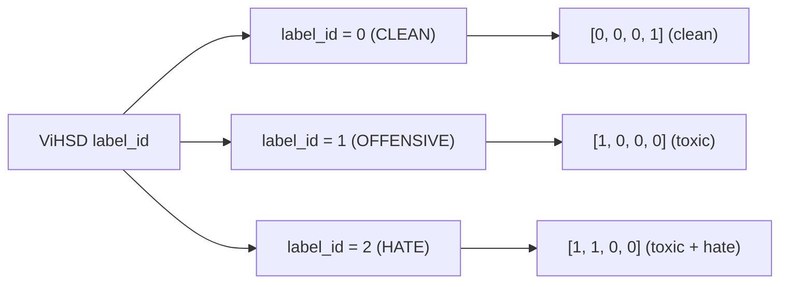

# 03. Thiết Kế Dữ Liệu Đa Nhãn (Multi-Label Dataset)

## 1. Bản Chất Bài Toán Phân Loại Đa Nhãn (Multi-Label)

Khác với phân loại đa lớp (Multi-Class - mỗi mẫu chỉ thuộc duy nhất một nhãn và tổng xác suất bằng 1), bài toán **Phân loại đa nhãn (Multi-Label)** cho phép một bình luận có thể đồng thời mang nhiều nhãn khác nhau hoặc không mang nhãn tiêu cực nào.

Mỗi mẫu dữ liệu $i$ được gán một vector nhị phân 4 chiều:
$$\mathbf{y}_i = [y_{\text{toxic}}, y_{\text{hate}}, y_{\text{spam}}, y_{\text{clean}}] \in \{0, 1\}^4$$

---

## 2. Định Nghĩa 4 Nhãn Mục Tiêu

| Tên nhãn | Định nghĩa ngữ nghĩa | Ví dụ minh họa | Trọng thái kích hoạt |
| :--- | :--- | :--- | :--- |
| **`toxic`** | Bình luận chứa từ ngữ chửi thề, thô tục, xúc phạm danh dự cá nhân, lăng mạ hoặc gây khó chịu chung | *"Hàng như lừa đảo, đm shop"* | $y_{\text{toxic}} = 1$ |
| **`hate`** | Phát ngôn thù ghét (Hate Speech), kích động thù hằn, phân biệt đối xử nhắm vào các nhóm đối tượng (chủng tộc, vùng miền, tôn giáo, giới tính) | *"Đm tụi miên này cút về nước đi"* | $y_{\text{hate}} = 1$ |
| **`spam`** | Bình luận quảng cáo rác, lặp lại vô nghĩa, điều hướng link độc hại hoặc spam kiếm tiền | *"Kiếm 500k/ngày tại link sau..."* | $y_{\text{spam}} = 1$ |
| **`clean`** | Bình luận an toàn, mang tính xây dựng, tích cực hoặc trung tính | *"Sản phẩm dùng rất ổn, giao hàng nhanh"* | $y_{\text{clean}} = 1$ |

> [!IMPORTANT]
> **Quy tắc ràng buộc logic của nhãn `clean`:**  
> Nhãn `clean` mang tính chất bù trừ. Một bình luận chỉ được coi là `clean = 1` khi và chỉ khi nó hoàn toàn không vi phạm bất kỳ hành vi tiêu cực nào:
> $$y_{\text{clean}} = 1 \iff (y_{\text{toxic}} = 0 \land y_{\text{hate}} = 0 \land y_{\text{spam}} = 0)$$

---

## 3. Quy Tắc Ánh Xạ Từ Tập ViHSD (Label Mapping)

Bộ dữ liệu ViHSD (do UIT-NLP phát hành) sử dụng cột `label_id` gồm 3 giá trị định lượng mức độ nghiêm trọng:



Bảng ánh xạ cụ thể:

| `label_id` ViHSD | Ý nghĩa nhãn gốc | Ánh xạ sang Multi-Label Vector `[toxic, hate, spam, clean]` | Diễn giải |
| :---: | :--- | :---: | :--- |
| **0** | Clean (Bình thường / Sạch) | `[0, 0, 0, 1]` | Hoàn toàn an toàn |
| **1** | Offensive (Thô tục / Xúc phạm) | `[1, 0, 0, 0]` | Độc hại nhưng chưa đến mức kích động thù ghét nhóm đối tượng |
| **2** | Hate (Phát ngôn thù ghét) | `[1, 1, 0, 0]` | Vừa mang tính thô tục độc hại, vừa mang tính kích động thù ghét |

> [!WARNING]
> **Điểm cần lưu ý về nhãn `spam` (`[TODO / UNKNOWN]`):**  
> Bản thân bộ dữ liệu ViHSD gốc không có nhãn `spam`. Khi gộp với `ViCTSD` hoặc `ViTHSD`, nhóm cần xác định rõ nguồn gán nhãn cho cột `spam`: lấy từ các mẫu quảng cáo/bình luận không liên quan trong ViCTSD, hay từ một tập dữ liệu bổ trợ riêng. Hiện tại đối với ViHSD đơn thuần, cột `spam` được mặc định bằng `0`.

---

## 4. Chiến Lược Gộp Và Phân Chia Dữ Liệu (Dataset Splitting)

### 4.1. Quy trình gộp dữ liệu (`data/raw/merged_dataset.csv`)
1. Đọc các tập ViHSD (`train.csv`, `dev.csv`, `test.csv`), ViCTSD và ViTHSD bằng bảng mã UTF-8.
2. Trích xuất cột văn bản (chuẩn hóa tên thành `text_raw`) và cột nhãn tương ứng.
3. Ánh xạ các nhãn thành 4 cột số nguyên nhị phân: `toxic`, `hate`, `spam`, `clean`.
4. Loại bỏ các dòng trống, trùng lặp hoặc chứa ký tự hỏng không thể phục hồi.
5. Lưu file hợp nhất tại `data/raw/merged_dataset.csv`.

### 4.2. Phân chia tập dữ liệu (Stratified Split)
Dữ liệu sạch được chia theo tỷ lệ kinh điển **80% - 10% - 10%**:
* `data/processed/train.csv` (80%): Sử dụng để huấn luyện mô hình.
* `data/processed/val.csv` (10%): Sử dụng để theo dõi loss, kiểm thử định kỳ sau mỗi epoch và chọn checkpoint tốt nhất.
* `data/processed/test.csv` (10%): Tập dữ liệu độc lập hoàn toàn, chỉ dùng để đánh giá báo cáo cuối cùng.

```python
from sklearn.model_selection import train_test_split
import pandas as pd

def split_multilabel_dataset(df: pd.DataFrame, random_state: int = 42):
    """
    Phân chia dữ liệu Stratified đảm bảo tỷ lệ phân bổ các nhãn độc hại
    """
    # Bước 1: Tách 80% Train và 20% Temp (Val + Test)
    train_df, temp_df = train_test_split(
        df, test_size=0.2, random_state=random_state, shuffle=True
    )
    
    # Bước 2: Tách 20% Temp thành 10% Val và 10% Test
    val_df, test_df = train_test_split(
        temp_df, test_size=0.5, random_state=random_state, shuffle=True
    )
    
    return train_df, val_df, test_df
```
