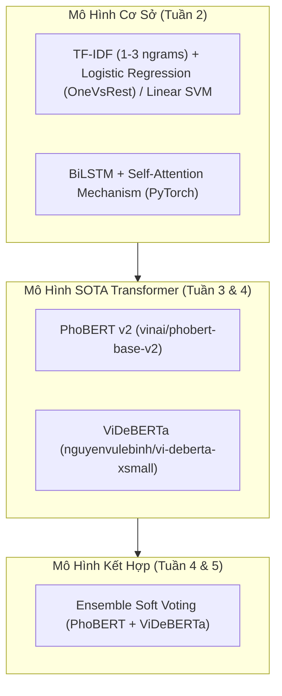

# 03. Thiết Kế Mô Hình & Hàm Mất Mát (Loss Functions)

## 1. Hệ Thống Các Mô Hình Được Thử Nghiệm

Dự án tiếp cận bài toán theo hình phễu, đi từ mô hình cơ sở đến các kiến trúc Transformer hiện đại nhất:



---

## 2. Kiến Trúc Transformer Đa Nhãn (Multi-Label Transformer)

Thay vì sử dụng hàm `Softmax` (vốn ép tổng xác suất các lớp bằng 1), bài toán đa nhãn sử dụng hàm `Sigmoid` độc lập ở tầng đầu ra:

```python
import torch
import torch.nn as nn
from transformers import AutoModel

class VietnameseMultiLabelClassifier(nn.Module):
    """
    Kiến trúc phân loại đa nhãn tùy biến cho PhoBERT hoặc ViDeBERTa
    """
    def __init__(self, model_name: str = "vinai/phobert-base-v2", num_labels: int = 4, dropout_rate: float = 0.2):
        super(VietnameseMultiLabelClassifier, self).__init__()
        self.backbone = AutoModel.from_pretrained(model_name)
        self.dropout = nn.Dropout(dropout_rate)
        self.classifier = nn.Linear(self.backbone.config.hidden_size, num_labels)
        
    def forward(self, input_ids, attention_mask):
        outputs = self.backbone(input_ids=input_ids, attention_mask=attention_mask)
        
        # Trích xuất vector đại diện [CLS]
        if hasattr(outputs, "pooler_output") and outputs.pooler_output is not None:
            pooled_output = outputs.pooler_output
        else:
            pooled_output = outputs.last_hidden_state[:, 0, :]
            
        x = self.dropout(pooled_output)
        logits = self.classifier(x)
        return logits  # Trả về logits thô (chưa qua Sigmoid)
```

---

## 3. Cài Đặt Hàm Mất Mát Xử Lý Mất Cân Bằng (Custom Loss)

### 3.1. Vấn đề mất cân bằng trong Toxic Comment
Trong tập dữ liệu thực tế, số lượng bình luận `clean` áp đảo hoàn toàn (~75-80%), trong khi `hate` chỉ chiếm khoảng 3-5%. Nếu sử dụng Cross-Entropy thông thường, mô hình sẽ bị thiên lệch sang lớp đa số.

### 3.2. Binary Focal Loss
Focal Loss bổ sung nhân tố điều chế $(1 - p_t)^\gamma$ vào hàm mất mát Binary Cross-Entropy (BCE) tiêu chuẩn:
$$FL(p_t) = -\alpha_t (1 - p_t)^\gamma \log(p_t)$$

Trong đó:
* $p_t$ là xác suất mô hình dự đoán đúng nhãn thực tế ($p$ nếu $y=1$ và $1-p$ nếu $y=0$).
* $\gamma$ (gamma) là tham số tập trung (focusing parameter). Khi mẫu dễ phân loại ($p_t \to 1$), hệ số $(1 - p_t)^\gamma \to 0$, triệt tiêu đóng góp loss của mẫu dễ. Giá trị thực nghiệm chuẩn là $\gamma = 2.0$.
* $\alpha_t$ là trọng số cân bằng lớp (thường chọn $\alpha = 0.25$).

```python
import torch
import torch.nn as nn
import torch.nn.functional as F

class BinaryFocalLoss(nn.Module):
    """
    Cài đặt Binary Focal Loss cho bài toán phân loại đa nhãn (Multi-Label)
    """
    def __init__(self, alpha: float = 0.25, gamma: float = 2.0, reduction: str = 'mean'):
        super(BinaryFocalLoss, self).__init__()
        self.alpha = alpha
        self.gamma = gamma
        self.reduction = reduction

    def forward(self, inputs: torch.Tensor, targets: torch.Tensor) -> torch.Tensor:
        """
        inputs: Logits thô từ classifier, kích thước (batch_size, num_labels)
        targets: Nhãn nhị phân thực tế, kích thước (batch_size, num_labels)
        """
        # Tính Binary Cross Entropy with Logits không lấy trung bình
        bce_loss = F.binary_cross_entropy_with_logits(inputs, targets, reduction='none')
        probs = torch.sigmoid(inputs)
        
        # Tính p_t cho từng phần tử
        p_t = probs * targets + (1.0 - probs) * (1.0 - targets)
        
        # Tính hệ số Alpha
        alpha_t = self.alpha * targets + (1.0 - self.alpha) * (1.0 - targets)
        
        # Tính trọng số Focal
        focal_weight = alpha_t * ((1.0 - p_t) ** self.gamma)
        
        # Tính mất mát Focal
        focal_loss = focal_weight * bce_loss

        if self.reduction == 'mean':
            return focal_loss.mean()
        elif self.reduction == 'sum':
            return focal_loss.sum()
        return focal_loss
```

---

## 4. Kỹ Thuật Kết Hợp Mô Hình (Ensemble Soft Voting)

Kết hợp hai mô hình Transformer đại diện cho hai trường phái kiến trúc:
1. **PhoBERT (RoBERTa):** Được huấn luyện trước trên 20GB văn bản tiếng Việt với BPE ở mức từ (Word-level).
2. **ViDeBERTa (DeBERTa):** Áp dụng Disentangled Attention giúp mã hóa riêng rẽ nội dung từ và vị trí tương đối.

### Thuật toán Soft Voting:
$$\hat{\mathbf{p}} = w_1 \cdot \sigma(\mathbf{z}_{\text{phobert}}) + w_2 \cdot \sigma(\mathbf{z}_{\text{videberta}})$$
Với trọng số mặc định $w_1 = 0.5, w_2 = 0.5$.

```python
import torch
import numpy as np

def ensemble_predict(
    phobert_model, 
    videberta_model, 
    phobert_inputs, 
    videberta_inputs, 
    weights=[0.5, 0.5], 
    threshold=0.5
):
    """
    Thực hiện suy luận kết hợp (Ensemble Inference) bằng Soft Voting
    """
    phobert_model.eval()
    videberta_model.eval()
    
    with torch.no_grad():
        # Lấy Logits và chuyển qua Sigmoid
        out_phobert = phobert_model(**phobert_inputs)
        prob_phobert = torch.sigmoid(out_phobert.logits if hasattr(out_phobert, 'logits') else out_phobert).cpu().numpy()
        
        out_videberta = videberta_model(**videberta_inputs)
        prob_videberta = torch.sigmoid(out_videberta.logits if hasattr(out_videberta, 'logits') else out_videberta).cpu().numpy()
        
    # Tính trung bình có trọng số xác suất
    final_probs = weights[0] * prob_phobert + weights[1] * prob_videberta
    
    # Ánh xạ qua ngưỡng quyết định (Thresholding)
    predictions = (final_probs >= threshold).astype(int)
    
    return final_probs, predictions
```

---

## 5. Các Chỉ Số Đánh Giá (Evaluation Metrics)

Hệ thống đánh giá trên tập kiểm thử độc lập (`test.csv`) thông qua các chỉ số:
1. **Macro-F1:**
   $$\text{Macro-F1} = \frac{1}{4} \sum_{c \in \{\text{toxic, hate, spam, clean}\}} F1_c$$
2. **Precision & Recall riêng cho từng nhãn:** Đặc biệt theo dõi sát lớp `hate` và `toxic` để tránh hiện tượng bỏ sót vi phạm (False Negative cao).
3. **Multi-label Confusion Matrix:** Đánh giá ma trận nhầm lẫn nhị phân riêng cho từng nhãn trong 4 nhãn.
