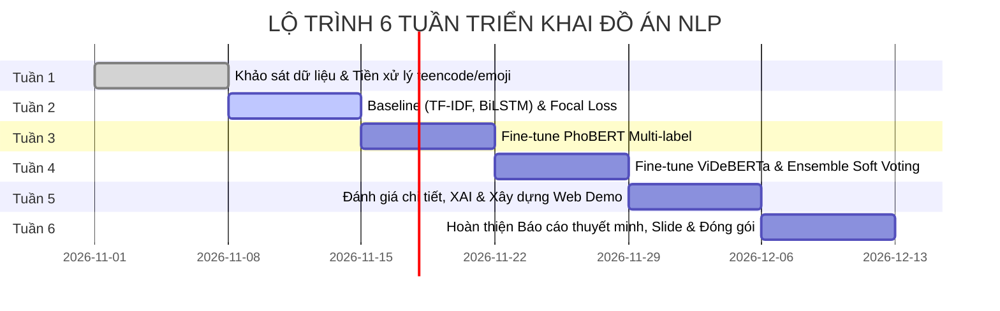

# 04. Lộ Trình Triển Khai Chi Tiết 6 Tuần

## 1. Tổng Quan Lộ Trình Đồ Án

Lộ trình được thiết kế trong thời gian 6 tuần dành cho nhóm 2 sinh viên, bảo đảm sự phân bổ đồng đều giữa nghiên cứu lý thuyết, thực nghiệm mô hình hóa và xây dựng sản phẩm bàn giao:

---

## 2. Kế Hoạch Chi Tiết Từng Tuần & Sản Phẩm Bàn Giao

### Tuần 1: Khảo Sát, Chuẩn Hóa Dữ Liệu Multi-Label & Module Tiền Xử Lý
* **Mục tiêu:** Xây dựng nền móng dữ liệu sạch, bộ từ điển đặc thù tiếng Việt và pipeline tiền xử lý tái sử dụng được.
* **Nội dung công việc:**
  * Khởi tạo cấu trúc repository GitHub chuẩn và liên kết Google Drive backup.
  * Tải dữ liệu từ 3 nguồn: ViHSD, ViCTSD, ViTHSD.
  * Xây dựng từ điển `data/dictionaries/teencode.json` và `data/dictionaries/emoji.json`.
  * Viết module `src/preprocessing.py` (Unicode NFC, regex URL/mentions, emoji, teencode, underthesea).
  * Gộp dữ liệu thành bảng chuẩn 4 nhãn `[toxic, hate, spam, clean]` (`data/raw/merged_dataset.csv`).
  * Thực thi tiền xử lý và phân chia dữ liệu Stratified Split: `train.csv` (80%), `val.csv` (10%), `test.csv` (10%).
  * Thực hiện phân tích EDA trên Jupyter Notebook (phân bố nhãn và phân bố độ dài câu).
* **Sản phẩm bàn giao:**
  * Thư mục từ điển `teencode.json`, `emoji.json`.
  * File mã nguồn `src/preprocessing.py`.
  * 3 file dữ liệu sạch trong `data/processed/` và sao lưu trên Google Drive.
  * Notebook `notebooks/01_eda_and_preprocessing.ipynb`.

---

### Tuần 2: Xây Dựng Mô Hình Baseline & Cài Đặt Custom Loss
* **Mục tiêu:** Thiết lập các mốc điểm chuẩn (Benchmark) và hoàn thiện hàm mất mát trị mất cân bằng dữ liệu.
* **Nội dung công việc:**
  * Xây dựng mô hình Baseline truyền thống: TF-IDF (1-3 n-grams) kết hợp Logistic Regression (OneVsRest) và Linear SVM.
  * Cài đặt mạng học sâu BiLSTM + Self-Attention trong PyTorch.
  * Cài đặt module hàm mất mát `src/loss.py`: Binary Focal Loss ($\gamma=2.0$) và BCEWithLogitsLoss có Pos-Weights.
  * Thử nghiệm so sánh hiệu năng ban đầu trên tập Validation.
* **Sản phẩm bàn giao:**
  * Module `src/loss.py` hoàn chỉnh.
  * Notebooks `02_baseline_tfidf_svm.ipynb` và `03_baseline_bilstm_attention.ipynb`.
  * Bảng số liệu đối sánh sơ bộ các mô hình Baseline.

---

### Tuần 3: Fine-Tuning PhoBERT Đa Nhãn & Thử Nghiệm Focal Loss
* **Mục tiêu:** Tinh chỉnh mô hình ngôn ngữ lớn PhoBERT v2 trên cấu trúc đa nhãn và tối ưu siêu tham số Focal Loss.
* **Nội dung công việc:**
  * Tải checkpoint `vinai/phobert-base-v2`.
  * Xây dựng Dataset & DataCollator tương thích với Trainer API hoặc native PyTorch loop.
  * Fine-tune PhoBERT với Binary Focal Loss.
  * Thử nghiệm thay đổi siêu tham số $\gamma \in [1.0, 2.0, 3.0]$ để tìm điểm cực đại Macro-F1.
  * Đối chiếu kết quả giữa huấn luyện có Focal Loss và Cross-Entropy thông thường.
* **Sản phẩm bàn giao:**
  * Checkpoint mô hình PhoBERT tốt nhất tại `saved_models/phobert_toxic/`.
  * Báo cáo thực nghiệm phân tích ảnh hưởng của tham số $\gamma$ trong Focal Loss.
  * Notebook `notebooks/04_phobert_fine_tuning.ipynb`.

---

### Tuần 4: Fine-Tuning ViDeBERTa & Thử Nghiệm Ensemble
* **Mục tiêu:** Huấn luyện mô hình Transformer thứ hai và tích hợp cơ chế kết hợp mô hình Soft Voting.
* **Nội dung công việc:**
  * Tinh chỉnh mô hình `nguyenvulebinh/vi-deberta-xsmall` (hoặc bản base) trên cùng bộ dữ liệu.
  * Đánh giá độc lập mô hình ViDeBERTa theo Macro-F1, Precision, Recall.
  * Triển khai hàm `ensemble_predict()` thực hiện Soft Voting trung bình có trọng số xác suất giữa PhoBERT và ViDeBERTa.
  * Tinh chỉnh ngưỡng phân loại (Threshold Tuning) cho từng nhãn.
* **Sản phẩm bàn giao:**
  * Checkpoint mô hình ViDeBERTa tại `saved_models/videberta_toxic/`.
  * Đoạn code suy luận Ensemble hoàn chỉnh.
  * Bảng điểm kiểm thử so sánh: PhoBERT vs ViDeBERTa vs Ensemble trên tập Test.

---

### Tuần 5: Đánh Giá Chuyên Sâu, XAI & Xây Dựng Web Demo
* **Mục tiêu:** Hoàn thiện giao diện ứng dụng tương tác thực tế và cơ chế giải thích mô hình (Explainable AI).
* **Nội dung công việc:**
  * Đánh giá toàn diện trên tập `test.csv`: Tính toán chi tiết Macro-F1, Precision, Recall cho từng lớp và vẽ Multi-label Confusion Matrix.
  * Cài đặt logic tô màu từ ngữ vi phạm trong `app/highlight.py` (kết hợp danh mục nhạy cảm và Attention Weights / LIME).
  * Phát triển giao diện Web Demo bằng Streamlit (`app/app.py`): nhập văn bản, hiển thị biểu đồ xác suất 4 nhãn và vùng tô màu cảnh báo.
  * Kiểm thử tương tác và đo lường thời gian phản hồi suy luận (Latency).
* **Sản phẩm bàn giao:**
  * Ứng dụng Web Demo Streamlit chạy trực quan.
  * Module giải thích tô màu từ ngữ `app/highlight.py`.
  * Bộ biểu đồ trực quan hóa ma trận nhầm lẫn và phân tích lỗi (Error Analysis).

---

### Tuần 6: Hoàn Thiện Báo Cáo Thuyết Minh & Đóng Gói Dự Án
* **Mục tiêu:** Nghiệm thu toàn bộ đồ án, chuẩn bị hồ sơ thuyết minh và đóng gói repository đạt chuẩn học thuật.
* **Nội dung công việc:**
  * Viết báo cáo thuyết minh đồ án (.pdf) đầy đủ các chương: Tổng quan, Cơ sở lý thuyết, Phương pháp đề xuất (Pipeline, Focal Loss, Ensemble), Thực nghiệm & Đánh giá, Kết luận.
  * Thiết kế Slide trình chiếu thuyết minh đồ án.
  * Quay Video Demo vận hành hệ thống thực tế.
  * Rà soát, dọn dẹp mã nguồn GitHub, kiểm tra tính tái tạo (Reproducibility) và hoàn thiện file `README.md`.
* **Sản phẩm bàn giao:**
  * File báo cáo đồ án hoàn chỉnh (.pdf).
  * Slide thuyết minh (.pptx / .pdf) và Video Demo (.mp4).
  * GitHub Repository chuẩn công nghiệp, sẵn sàng nghiệm thu trước hội đồng.
