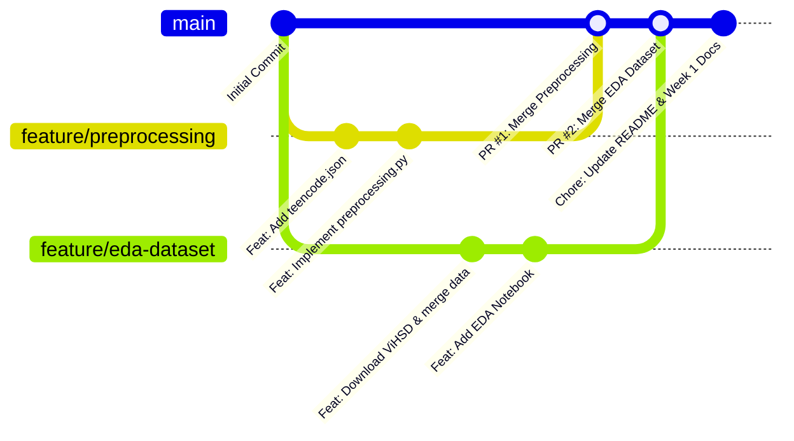
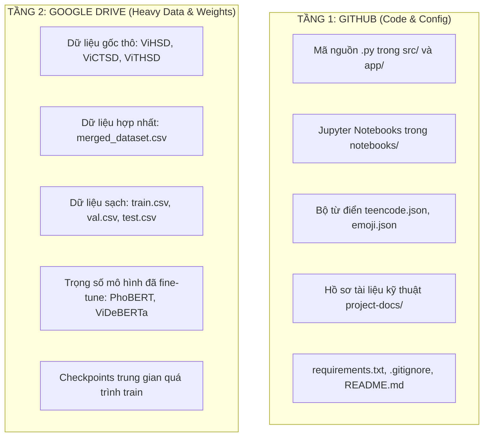

# 04. Quy Trình Quản Lý Git & Chiến Lược Sao Lưu (Backup Strategy)

## 1. Mô Hình Quản Lý Phiên Bản Bằng Git (Git Branching Workflow)

Để bảo đảm tính ổn định của mã nguồn và tránh xung đột mã lệnh (merge conflicts) khi 2 sinh viên cùng lập trình, nhóm áp dụng mô hình Feature Branch Workflow:



### Nguyên Tắc Bắt Buộc:
1. **Không push trực tiếp lên nhánh `main`:**
   * Nhánh `main` là nhánh sản phẩm, luôn luôn trong trạng thái mã nguồn chạy được và không có lỗi cú pháp.
2. **Quy ước đặt tên nhánh:**
   * Tiền xử lý & Từ điển: `feature/preprocessing`
   * Dữ liệu & Phân tích EDA: `feature/eda-dataset`
   * Huấn luyện Baseline: `feature/baseline-models`
   * Huấn luyện PhoBERT: `feature/phobert-finetune`
   * Xây dựng Web Demo: `feature/streamlit-demo`
3. **Quy trình Pull Request (PR) & Code Review chéo:**
   * Sau khi hoàn tất công việc trên nhánh tính năng, sinh viên đẩy nhánh lên GitHub:
     ```bash
     git push origin feature/<ten-nhanh>
     ```
   * Mở giao diện GitHub $\to$ Tạo **Pull Request** gộp vào `main`.
   * Thành viên còn lại vào kiểm tra code (Code Review), comment nếu cần chỉnh sửa, và bấm **Merge Pull Request**.

---

## 2. Cấu Hình File `.gitignore` Chuẩn Công Nghiệp

Do GitHub áp đặt giới hạn kích thước mỗi file không vượt quá **100MB** và khuyến nghị dưới **50MB**, toàn bộ file dữ liệu nặng và trọng số mô hình bắt buộc phải được loại trừ khỏi Git:

```plaintext
# === Virtual Environments ===
venv/
env/
__pycache__/
*.pyc

# === Large Data & Datasets (Bảo vệ dữ liệu nặng) ===
data/raw/*
data/processed/*
!data/raw/.gitkeep
!data/processed/.gitkeep

# === Saved Models & Model Weights (>100MB) ===
saved_models/*
!saved_models/.gitkeep
*.pth
*.bin
*.onnx
*.safetensors
*.pt

# === Jupyter Notebook Checkpoints ===
.ipynb_checkpoints/
*-checkpoint.ipynb

# === IDE Configurations ===
.vscode/
.idea/

# === Temporary & Streamlit Secrets ===
.streamlit/secrets.toml
tmp/
*.log
```

---

## 3. Chiến Lược Sao Lưu 2 Tầng (Two-Tier Backup Strategy)

Dự án áp dụng mô hình phân tách lưu trữ 2 tầng rõ ràng:



### Hướng Dẫn Đồng Bộ Tầng 2 (Google Drive):
1. **Khởi tạo thư mục Google Drive chung:** Đặt tên thư mục `[NLP_Project]_Toxic_Comment_Detection_Backup` và cấp quyền truy cập chỉnh sửa (Editor) cho cả 2 tài khoản Google của nhóm.
2. **Cấu trúc thư mục trên Google Drive:**
   ```text
   Google Drive/
   └── [NLP_Project]_Toxic_Comment_Detection_Backup/
       ├── 01_raw_datasets/             # train.csv, dev.csv, test.csv từ ViHSD/ViCTSD
       ├── 02_processed_datasets/       # train.csv, val.csv, test.csv đã tiền xử lý
       └── 03_saved_checkpoints/        # Checkpoint PhoBERT v2, ViDeBERTa tốt nhất
   ```
3. **Kỷ luật sao lưu:** Mỗi khi tạo ra một phiên bản dữ liệu sạch mới hoặc hoàn tất một đợt huấn luyện mô hình tốn nhiều giờ, sinh viên phụ trách phải lập tức upload bản sao lên Google Drive và ghi chú phiên bản vào báo cáo tiến độ.
