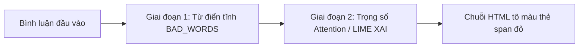

# 05. Hướng Dẫn Phát Triển Web Demo & Trực Quan Hóa (XAI)

## 1. Mục Tiêu Của Ứng Dụng Web Demo

Ứng dụng Web Demo (đặt tại thư mục `app/`) phục vụ mục đích kiểm thử tương tác và nghiệm thu sản phẩm bàn giao cuối kỳ. Giao diện được xây dựng bằng **Streamlit** nhờ ưu điểm triển khai nhanh, hỗ trợ hiển thị thành phần đồ họa phong phú và nhúng mã HTML/CSS tùy biến.

**Các tính năng chính của Web Demo:**
1. Khung nhập bình luận văn bản tự do theo thời gian thực.
2. Nút kích hoạt phân tích đa nhãn (`toxic`, `hate`, `spam`, `clean`).
3. Thanh hiển thị tỷ lệ phần trăm độ tin cậy (Confidence score) cho từng nhãn.
4. Vùng cảnh báo trực quan: Đổi màu cảnh báo (Xanh: An toàn, Đỏ: Độc hại/Thù ghét).
5. Tô màu làm nổi bật trực tiếp các từ ngữ vi phạm trong câu.

---

## 2. Kỹ Thuật Tô Màu Từ Ngữ Vi Phạm (Highlighting Engine)

Nhóm chia kỹ thuật giải thích và tô màu vi phạm thành hai giai đoạn triển khai:



### Giai đoạn 1: Tô màu dựa trên từ điển nhạy cảm (`app/highlight.py`)
Áp dụng danh sách từ điển các từ ngữ thô tục, chửi thề thường gặp để dò tìm và đóng gói thẻ HTML `<span>` có nền màu đỏ nổi bật:

```python
# app/highlight.py
import re

# Danh sách từ điển vi phạm tiêu biểu
BAD_WORDS = [
    "địt", "đm", "dcm", "lồn", "cl", "vcl", "vãi", "cực cợt", 
    "lừa đảo", "chó", "súc vật", "cút", "con mẹ mày"
]

def highlight_toxic_words(text: str, bad_words: list = BAD_WORDS) -> str:
    """
    Dò quét và tô màu nền đỏ cho các từ ngữ nằm trong danh sách vi phạm
    """
    words = text.split()
    highlighted_tokens = []
    
    for word in words:
        clean_word = word.strip(",.?!:;\"'").lower()
        if clean_word in bad_words:
            # Bọc thẻ span có màu nền đỏ đậm, chữ trắng
            highlighted_tokens.append(
                f'<span style="background-color: #e74c3c; color: white; '
                f'padding: 2px 6px; border-radius: 4px; font-weight: bold;">{word}</span>'
            )
        else:
            highlighted_tokens.append(word)
            
    return " ".join(highlighted_tokens)
```

### Giai đoạn 2: Nâng cấp bằng Explainable AI (LIME / Attention Weights)
Thay vì dùng từ điển tĩnh, hệ thống sử dụng thư viện `lime` hoặc trích xuất trọng số Self-Attention của lớp Transformer cuối cùng để xác định điểm đóng góp (Attribution Score) của từng từ đối với xác suất lớp `toxic` / `hate`. Các từ có trọng số đóng góp vượt ngưỡng sẽ được tự động tô màu theo dải màu nhiệt (Heatmap).

---

## 3. Mã Nguồn Giao Diện Hoàn Chỉnh (`app/app.py`)

```python
# app/app.py
import streamlit as st
import numpy as np
from highlight import highlight_toxic_words

# Cấu hình trang web Streamlit
st.set_page_config(
    page_title="Hệ Thống Phát Hiện Bình Luận Độc Hại",
    page_icon="🛡️",
    layout="centered"
)

st.title("🛡️ Hệ Thống Tự Động Phát Hiện Bình Luận Độc Hại")
st.markdown("*Mô hình phân loại đa nhãn tiếng Việt sử dụng PhoBERT & ViDeBERTa (Ensemble)*")
st.write("---")

# Khung nhập văn bản của người dùng
user_input = st.text_area(
    "Nhập nội dung bình luận cần kiểm tra:",
    value="Sản phẩm như lừa đảo, dùng vcl thật sự!!",
    height=120
)

col1, col2 = st.columns([1, 4])
with col1:
    btn_predict = st.button("🔍 Phân tích", use_container_width=True)

if btn_predict:
    if not user_input.strip():
        st.warning("Vui lòng nhập nội dung bình luận!")
    else:
        # TODO: Ở Tuần 5, kết nối gọi hàm ensemble_predict() thực tế từ checkpoint
        # Dưới đây là mô phỏng luồng hiển thị giao diện:
        mock_probs = {
            "toxic": 0.94,
            "hate": 0.12,
            "spam": 0.05,
            "clean": 0.04
        }
        
        is_toxic = mock_probs["toxic"] >= 0.5 or mock_probs["hate"] >= 0.5
        
        st.write("### Kết Quả Đánh Giá:")
        if is_toxic:
            st.error(f"🚨 **CẢNH BÁO: BÌNH LUẬN CÓ YẾU TỐ ĐỘC HẠI!**")
        else:
            st.success("✅ **BÌNH LUẬN AN TOÀN (CLEAN)**")
            
        # Hiển thị thanh tiến trình xác suất 4 nhãn
        st.write("#### Xác suất chi tiết từng nhãn:")
        for label, prob in mock_probs.items():
            st.write(f"- **{label.upper()}**: {prob * 100:.2f}%")
            st.progress(float(prob))
            
        # Vùng trực quan hóa tô màu từ ngữ vi phạm
        if is_toxic:
            st.write("---")
            st.write("#### Chi tiết từ ngữ vi phạm:")
            rendered_html = highlight_toxic_words(user_input)
            st.markdown(
                f'<div style="background-color: #f8f9fa; padding: 15px; border-radius: 8px; border: 1px solid #dee2e6;">{rendered_html}</div>', 
                unsafe_allow_html=True
            )
```

---

## 4. Hướng Dẫn Khởi Chạy Ứng Dụng Demo

Kích hoạt môi trường ảo và khởi chạy Streamlit từ thư mục gốc của dự án:

```bash
# Kích hoạt venv
# Windows: venv\Scripts\activate | Linux/macOS: source venv/bin/activate

# Chạy ứng dụng Streamlit
streamlit run app/app.py
```
Trình duyệt sẽ tự động mở giao diện tại địa chỉ cục bộ: `http://localhost:8501`.
